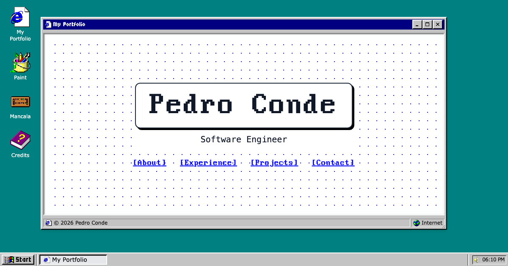

# 🖥️ Ppconde OS

My portfolio, built as a Windows 98 desktop that runs in the browser.

**Live:** [os.ppconde.com](https://os.ppconde.com)



## What's inside

- **My Portfolio**: a browser window with my about, experience, projects (pulled live from my pinned GitHub repos) and a contact form
- **Paint**: a small drawing app
- **Mancala**: a multiplayer lounge where visitors walk around, chat and play Mancala against each other or the computer
- A BIOS boot screen, a Start menu, draggable windows, and a blue screen for errors

## Stack

- [React Router](https://reactrouter.com/) (framework mode) with React 19 and server rendering
- [Cloudflare Workers](https://developers.cloudflare.com/workers/): KV caches the GitHub data, and a Durable Object with WebSockets runs the Mancala lounge
- Tailwind CSS, Zustand, Zod
- Playwright for end-to-end tests, Biome for linting and formatting

## Running locally

Needs Node (see `.nvmrc`) and pnpm.

```sh
pnpm install
pnpm run dev
```

The Projects page needs a GitHub token. See [DEV-NOTES.md](DEV-NOTES.md) for that and for CI setup.

| Command | What it does |
| --- | --- |
| `pnpm run dev` | Start the dev server |
| `pnpm run typecheck` | Generate route types and type-check |
| `pnpm run check` | Lint and format with Biome, applying fixes |
| `pnpm test` | Run the Playwright tests |
| `pnpm run deploy` | Build and deploy to Cloudflare |

## Credits

- [Henry Heffernan](https://henryheffernan.com/), whose portfolio OS inspired this project
- [Bruno Simon](https://bruno-simon.com/), for the Three.js Journey course
- [Mr.doob](https://mrdoob.com/), for being such an inspirational human being
